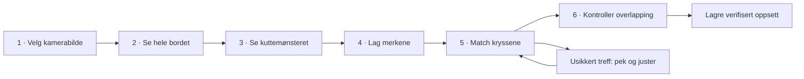

# Plan for kamera og kalibrering i modCut

Dato: 14. oktober 2026. Status: forslag til senere implementasjon; funksjonene er ikke bygget.

## 1. Mål og anbefalt første leveranse

Brukeren skal kunne koble til et kamera, se materialene på laserbordet og plassere designet direkte over kamerabildet. Kameraet er en selvstendig forbindelse: det kan være koblet til datamaskinen, en separat kameravert eller nettverket, og skal fungere selv om laseren er frakoblet.

Første leveranse prioriterer **ett fast kamera rett over hele laserbordet**, en enkel oppsettsveiviser og en kalibreringsjobb som lager tydelige merker med laseren. Brukeren tar et bilde og klikker på de nummererte kryssene på materialet; appen kjenner punktenes faktiske koordinater fra kuttejobben og tilpasser bildet til workplane. Automatikk foreslår innstillinger og kan hjelpe med å finne merkene. Avansert-panelet gir mer kontroll uten å gjøre normal oppstart vanskelig.

MVP omfatter USB/UVC-kamera på datamaskinen og HTTP-bilder fra en separat kameravert, inkludert VisiCam. Fullføring av fase 0–3 gir denne leveransen. Kamera inne i maskinen kan også brukes dersom det gir tilgjengelige bilder fra en fast posisjon. Flere kameraer og kamera på et bevegelig laserhode kommer senere.

## 2. Hva VisiCut og VisiCam gjør

VisiCut henter bilder fra en separat HTTP-server. Oppsettet støtter søk etter VisiCam og manuell bilde-URL. Kalibreringen lager nummererte kryss med laseren; brukeren tar et nytt bilde og drar skjermmarkørene til kryssene. Manualen anbefaler fire punkter og en etterfølgende kontroll. Dette gir et godt utgangspunkt for modCuts veiviser. [VisiCut-manualen](https://github.com/t-oster/VisiCut/wiki/VisiCut-manual).

VisiCam bruker OpenCV gjennom JavaCV til å finne fire faste markører og korrigere perspektivet. Kameraet kan være koblet til en separat datamaskin. Markørsøkets områder konfigureres i kameratjenesten. modCut bør kunne konsumere dette bildet, og senere tilby tilsvarende markørsporing i sitt eget oppsett. [VisiCam README](https://github.com/t-oster/VisiCam/blob/master/README.md).

VisiCuts manual beskriver fire kalibreringskryss, mens VisiCams README beskriver en eldre flyt med to. modCut skal ha én tydelig, versjonert prosedyre med fire hjørnenære punkter og et obligatorisk kontrollpunkt i midten. To punkter er ikke tilstrekkelig for generell perspektivkalibrering.

Det finnes innebygde løsninger med både oversikts- og nærkamera: xTool dokumenterer separat kalibrering av disse for P2-serien. Det viser at ulike kameraroller må kunne ha egne kalibreringer. Dokumentasjonen bekrefter ikke et generelt tilgjengelig tredjeparts-API; konkret integrasjon må undersøkes før støtte loves. [Oversiktskamera](https://support.xtool.com/article/1752), [nærkamera](https://support.xtool.com/article/1751).

**Anbefaling:** bruk VisiCuts prinsipp med uavhengig bildeleverandør og laserproduserte referanser, men samle oppsett, bildekvalitet, kalibrering og verifikasjon i modCut. Gamle VisiCam-installasjonsoppskrifter skal ikke være et krav for nye brukere.

## 3. Brukeropplevelse

**Overordnet designkrav:** løsningen skal være så grafisk som mulig. Kamerabildet er hovedflaten gjennom hele oppsettet. Brukeren velger, peker, drar og sammenligner direkte i bildet. Korte instruksjoner og tall støtter den visuelle handlingen. Tekniske parametere samles i Avansert, mens nødvendige material- og jobbvalg fortsatt vises før kutting.

### 3.1 Inngang og daglig bruk

Legg til **Kamera** i Cut-verktøylinjen og en Kamera-seksjon på maskinprofilen. Knappen viser **Sett opp kamera** før første oppsett. Etterpå finnes følgende hurtigkontroller:

- En tydelig bryter med teksten **Kamerabilde av / på**. Aktiv tilstand vises med både tekst og symbol.
- **Ta bilde** for å hente et nytt stillbilde av arbeidsflaten til plassering.
- **Livevisning**, gjennomsiktighet, **Kalibrer** og **Avansert** under en sekundær meny.

Normal daglig bruk skal bare kreve bryteren og **Ta bilde**. Når bryteren slås av, skjules bildet og eventuell live-feed stoppes eller pauses. Design, plassering og lagret kalibrering beholdes. Når bryteren slås på igjen, vises siste stillbilde med tidspunkt; et gammelt bilde markeres tydelig, og brukeren kan ta et nytt. Første gang uten et stillbilde hentes ett automatisk hvis kameraet er tilgjengelig. Ingen live-feed starter automatisk bare fordi bryteren slås på. Livevisning er et valgfritt hjelpemiddel før et nytt plasseringsbilde tas.

Vis separat status for kamera og laser. Et fungerende kamera skal aldri gjøre at laseren fremstår som tilkoblet. På bildet vises tidspunkt, valgt maskin, kalibreringsstatus og referansehøyde.

Arbeidsflyten er: legg inn materiale → slå på kamerabildet → ta bilde → dra designet dit det er ledig plass på materialet → kontroller rammen → kjør gjennom vanlig jobbkontroll. Stillbildet fryses under plassering, slik at liveoppdatering ikke flytter referansen. Brukeren kan alltid hente et nytt bilde. Appen skal ikke kreve ny kalibrering for hvert bilde når oppsett, koordinatreferanse og overflatehøyde fortsatt stemmer. Brukeren vurderer ledig plass visuelt; automatisk materialgjenkjenning eller automatisk nesting er ikke nødvendig for denne flyten.

Kamerabildet ligger under designet, følger samme pan/zoom og kan ikke velges som et designobjekt. Kameraoppdateringer skal ikke lage undo-steg, endre dokumentets dirty-status eller påvirke kuttebaner. Kameraet er i første omgang tilgjengelig i Cut; Draw trenger ikke kamera for å fungere.

### 3.2 Oppsettsveiviser

| Trinn | Det brukeren gjør | Det appen gjør |
|---|---|---|
| 1. Velg kamera | Velger et kamera fra en liste med miniatyrbilder, eller «Legg til nettverkskamera». | Finner lokale kameraer etter nødvendig OS-tillatelse. Søker etter støttede kameratjenester på lokalt nettverk. |
| 2. Kontroller utsnitt | Monterer kameraet stabilt over bordet og bekrefter retningen. | Foreslår oppløsning, viser hele bildet og hjelper med dekning, skarphet og lys. |
| 3. Klargjør kalibrering | Bekrefter maskin, bordmål, koordinatreferanse, materiale, overflatehøyde og kjent kutteprofil. | Lager en egen kalibreringsjobb innenfor bordet og det bekreftede materialområdet. |
| 4. Lag merkene | Ser forhåndsvisning og starter eller sender jobben med vanlig jobbkontroll. | Bruker eksisterende maskindriver og jobbvalidering. Venter på bekreftelse om at fysisk jobb er ferdig. |
| 5. Match bildet | Tar bilde uten å flytte materialet, og klikker på kryssene som fremheves ett om gangen. Kan godta automatiske treff. | Knytter hvert klikk til kjent punkt-ID og mm-koordinat fra kalibreringsjobben; beregner og viser bildekartlegging. |
| 6. Verifiser og lagre | Kontrollerer egne testmerker og godkjenner resultatet. | Viser målt avvik og dekningsområde; lagrer først når kontrollen er fullført. |

«Tilbake» beholder utfylte valg. Avbrutt veiviser beholder den gamle gyldige kalibreringen. En ny kalibrering opprettes som utkast og erstatter den gamle atomisk etter godkjenning.

### 3.3 Automatikk og Avansert

| Område | Standard | Avansert |
|---|---|---|
| Tilkobling | Liste over kameraer med forhåndsvisning; automatisk gjenkobling til samme identitet. | URL, autentisering, transport, tidsavbrudd og eksplisitt valg av kilde. |
| Bildefangst | Beste testede modus med god skarphet og akseptabel responstid; eksempelvis 1920 × 1080 hvis støttet. | Oppløsning, oppdateringsintervall, eksponering og fokus når kameraet tilbyr dette. |
| Orientering | Visuelt forslag og bekreftelse i veiviseren. | Rotasjon og speiling med tydelig preview. |
| Kalibrering | Anbefalt 3 × 3-mønster med ni kryss over hele området, omtrent 10 mm inn fra kanten. Brukeren klikker på kryssene; automatisk søk kan hjelpe. | Tettere mønster, innrykk, søkeområder og linsekalibrering. |
| Plassering | Lagret kartlegging for bekreftet overflatehøyde. | Navngitte høydeprofiler og separat finjustering av X/Y og rotasjon. |
| Visning | Frosset plasseringsbilde med timestamp. | Livefrekvens, gjennomsiktighet og teknisk kvalitetsrapport. |

Automatikk velger aldri en tilfeldig kilde ved flere kandidater, og setter aldri effekt/hastighet ut fra kameraet. En finjustering lagres separat, kan nullstilles og krever ny verifikasjon. Den skal ikke skjule en dårlig grunnkalibrering.

### 3.4 Visuell struktur i veiviseren

Åpne en romslig veiviser med ett hovedbilde, en kort instruksjon og én tydelig neste handling per trinn. På vanlig desktop skal bildet oppta omtrent 70–80 % av innholdsflaten. Et smalt panel viser bare det som trengs nå. På mindre vinduer legges kontrollene under bildet uten å skjule markørene. Avansert åpnes som et sammenleggbart panel ved siden av bildet; endringer har umiddelbar forhåndsvisning.

Vis seks navngitte trinn med symbol, nummer og tekst øverst. Fullførte trinn får en hake. Brukeren kan gå tilbake til fullførte trinn; endringer som påvirker kalibreringen merker senere trinn som «må kontrolleres på nytt». En kort animasjon eller illustrasjon viser den fysiske handlingen når brukeren skal montere kamera, legge inn arket eller la materialet ligge urørt.



Prinsippskisse for matching, ikke en ferdig skjermdesign:

```text
┌───────────────────────────────────────────────────────────────────────┐
│ ✓ Kamera   ✓ Utsnitt   ✓ Mønster   ✓ Kutt   ⑤ Match   ⑥ Kontroller     │
├───────────────────────────────────────────────────┬───────────────────┤
│                                                   │ Match kryss 3     │
│  ① +                                     + ②      │                   │
│                                                   │ [Forstørret bilde]│
│             Stort kamerabilde                     │ [    krysshår   ] │
│                                                   │                   │
│  ③ ◎ ← dra til senteret                  + ④      │ 1 ✓  2 ✓  3 ◉  4 ○│
│                                                   │                   │
│  [−] [+] [Vis hele bordet] [Original / Korrigert]   │ [Prøv å finne]    │
├───────────────────────────────────────────────────┴───────────────────┤
│ Dra markøren til midten av kryss 3.         Tilbake   [Bruk dette punktet]│
└───────────────────────────────────────────────────────────────────────┘
```

### 3.5 Grafiske handlinger i hvert trinn

| Trinn | Grafisk løsning | Viktig oppførsel |
|---|---|---|
| Velg kamera | Store kort med fersk miniatyrvisning, kameranavn og symbol for USB/nettverk. Klikk et kort for stort bilde. | Vis faktisk bilde når tilgjengelig; forklar manglende tilgang på kortet. «Legg til nettverkskamera» åpner ett adressefelt og bildeprøve. |
| Se hele bordet | Kamerabildet med hjelpelinjer, eksempelillustrasjon av overheadmontering og tydelig retningspil. Egne knapper for 90° rotasjon og speiling. | Orientering skal kunne rettes i normal flyt. Et foreslått eller manuelt markert utsnitt vises som utkast, uten å påstå at millimeterkartleggingen er kjent. |
| Klargjør mønster | Målsatt bordillustrasjon med materialrektangel, nummererte kryss og markert kutteområde. Dra materialrektangelets kanter i denne skjematiske bordvisningen; eksakte mål kan skrives inn. | Vis maskin/materiale/profil som kompakte valgkort og overflatehøyde som en enkel sideillustrasjon med mm-felt. Bekreft fysisk plassering og kjent origin før kutting. |
| Lag merkene | Stor mønsterpreview og en kort illustrert sekvens: legg inn → lukk lokk → kjør → la arket ligge. | Skill visuelt mellom «Sendt til laser» og «Kuttet ferdig». Framdrift vises bare når den er kjent; ellers vises ventetilstand og «Merkene er ferdige». |
| Match kryssene | Stort fotografi og instruksjonen «Klikk i midten av kryss N», mønsterkart, framdrift og forstørret utsnitt. Automatisk forslag og drajustering er hjelpemidler. | Fremhev ett punkt om gangen; behold oversikten over alle. Usikre forslag får symbol og forklaring. Ett tydelig valg godkjenner sikre forslag samlet. |
| Kontroller | Tegn forventet kontrollmerke over fotografert merke, med forstørrede utsnitt og synlige avstandslinjer. Skraver uverifisert område. | Vis største avvik i mm og «Godkjent»/«Trenger justering». RMS og øvrige tekniske mål kan åpnes under Detaljer. |

En grov utsnittsmarkering i kamerabildet og materialrektangelet i bordillustrasjonen er to ulike ting. Før kalibrering skal appen ikke bruke den første som bevis på hvor et kutt vil treffe.

### 3.6 Grafisk verifikasjon og finjustering

Verifikasjonsbildet skal gjøre avvik forståelig uten at brukeren må lese en rapport. For hvert kontrollpunkt vises fotografert senter og forventet senter med forskjellige former og en kort forbindelseslinje. Klikk et punkt for et forstørret utsnitt med målt avvik. Dersom avvik må forstørres for å være synlig, merkes visningen med forstørrelsesfaktoren; hovedbildet viser alltid faktisk plassering.

Tilby en sammenligningsslider og en av/på-knapp for referanseoverlay. Brukeren kan dermed se både kuttemerkene og forventet mønster uten at grafikken dekker detaljene. En valgfri sammenligning som veksler mellom visningene styres av brukeren og følger innstillingen for redusert bevegelse.

Finjustering i Avansert skjer med et eget transformverktøy: dra bildet for X/Y og bruk rotasjonshåndtak rundt et synlig dreiepunkt. Vis endringen i mm/grader ved håndtaket, med eksakte felt og piltaster som alternativ. Ha **Nullstill justering**, **Avbryt** og **Kontroller på nytt**. Verktøyet aktiveres eksplisitt, slik at vanlig dragging fortsatt flytter designet. Etter en endring vises den nye justeringen som utkast til kontrollen er bestått.

### 3.7 Daglig plassering og senere flerkameravisning

I Cut ligger en kompakt kameralinje over arbeidsflaten: **Kamerabilde av / på**, **Ta bilde** og en meny for øvrige kontroller. Kameranavnet kan vises ved bryteren. Et diskret merke på selve bildet viser «Stillbilde · tatt/mottatt …» og kalibreringsstatus. Ved manglende fangsttidspunkt brukes «mottatt», ikke «tatt». Materialet og designet skal fortsatt ha mest visuell plass.

Vis verifisert område med en tynn kontur. Uverifiserte deler får skravering og forklaring når de berøres. Ved høydebytte vises en liten sideillustrasjon av bord, materiale og referanseplan med direkte valg av en verifisert høydeprofil. Bekreft oppdatert bilde før videre kamerabasert plassering.

For flere kameraer brukes miniatyrkort og et lite bordkart som viser hvert kameras dekning. Klikk et område eller kort for å velge kamera. Når automatisk kameravalg senere innføres, markeres aktiv kilde tydelig. Nærbilder åpnes som et forstørret utsnitt med synlig kobling til stedet på oversiktskartet.

### 3.8 Tilgjengelighet og visuelle ferdigkriterier

Status formidles med symbol/form og kort tekst i tillegg til farge. Alle drahandlinger skal ha tastatur- og tallfeltalternativ. Markører får store treffområder uten at selve presisjonspunktet blir stort. Zoom skal ikke endre punktenes bordkoordinater, og fokusringer skal være synlige i begge temaer.

Før MVP godkjennes skal følgende være oppfylt:

- Kamera velges ved å kjenne igjen bildet, uten behov for tekniske enhets-ID-er.
- Montering, retning, mønsterplassering, matching og avvik kan forstås fra hovedbildet og korte instruksjoner.
- Brukeren kan fullføre normal flyt uten å åpne Avansert eller redigere transformasjonsmatriser.
- Automatikk viser forslag i bildet og gir direkte mulighet til å korrigere dem.
- Manuell matching og grafisk finjustering kan utføres med mus eller tastatur.
- Teknisk diagnostikk kan åpnes ved behov; kameraet forblir synlig mens innstillinger justeres.

## 4. Kameraer og uavhengig tilkobling

| Kilde | Prioritet | Implementasjon og avgrensning |
|---|---|---|
| USB/UVC på datamaskinen | MVP | Bruk Electron/Chromium `getUserMedia` og `enumerateDevices`; håndter OS-tillatelse og enhetsbytte. |
| HTTP JPEG/PNG | MVP | Hent stillbilder gjennom en avgrenset tjeneste i Electron main; støtt manuell URL og test tilkobling. |
| VisiCam `/image` | MVP | Bruk HTTP-adapter. Behandle perspektivkorrigert bilde som egen kildemodus; unngå dobbel linsekorrigering. Søkprotokoll må verifiseres i fase 0. |
| USB-kamera på separat Pi/PC | MVP via HTTP | Kameraverten må eksponere et støttet bildeendepunkt. Appen kan ikke finne en fjern USB-enhet gjennom lokal kameraenumerering. |
| MJPEG | Etter MVP | Egen adapter med kontrollert dekoding, avbrudd og minnegrenser. |
| RTSP/ONVIF | Senere, behovsstyrt | Krever utredning av oppdagelse, dekoder og distribusjon; ikke direkte støtte gjennom `getUserMedia`. |
| Innebygget kamera | Kandidat per modell | Samme adapter hvis tilgjengelig via UVC eller bilde-URL. Proprietær tilgang krever en dokumentert leverandøradapter. |
| Flere faste kameraer | Senere | Individuell kalibrering og dekning i felles millimeterkoordinater. |
| Kamera på bevegelig hode | Senere | Krever kjent fangstposisjon og maskinstatus; kan ikke behandles som et fast kamera. |

Automatisk nettverksoppdagelse begrenses til kjente annonseringsprotokoller. mDNS/DNS-SD kan brukes for tjenester som faktisk annonserer seg slik; det antas ikke at VisiCam gjør det. Ingen generell scanning av alle IP-adresser. Et kamera uten oppdagelsesstøtte settes opp med URL i vanlig flyt, uten at brukeren må åpne Avansert.

Lagre kameraets endpoint separat fra laserens host/port. Maskinprofilen knyttes til et kameraoppsett for riktig bordgeometri, men forbindelsene har uavhengig start, stopp, feiltilstand og gjenkobling. Et VisiCam-oppsett må registrere at endringer i serverens utsnitt/korrigering kan ugyldiggjøre modCuts kartlegging.

## 5. Kalibreringsjobb som gjør oppretting enkelt

### 5.1 Mønster og gjennomføring

**Anbefalt mønster:** ni nummererte kryss i et 3 × 3-rutenett som dekker hele det bekreftede kalibreringsområdet. Fire ligger nær hjørnene, fire ved midten av kantene og ett i midten. Dette gir flere steder å kontrollere opprettingen enn bare hjørnene. Brukeren skal ikke måtte velge antall punkter i normal flyt.

```text
    ┌────────────────────────────────┐
    │  + 1          + 2         + 3  │
    │                                │
    │  + 4          + 5         + 6  │
    │                                │
    │  + 7          + 8         + 9  │
    └────────────────────────────────┘
        Ca. 10 mm inn til ytre sentre
```

De følgende hjørnerollene 1–4 og M beskriver geometrien, ikke den trykte nummereringen i dette rutenettet. I standardmønsteret er kryss 1, 3, 7 og 9 tilpasningspunkter; kryss 2, 4, 5, 6 og 8 er uavhengige kontrollpunkter. Kryss 5 i midten er alltid obligatorisk. Jobbmetadata lagrer både synlig nummer og teknisk rolle, slik at brukeren kun trenger å følge nummereringen.

Ved behov tilbys **Flere punkter** med eksempelvis et 5 × 5-mønster i Avansert. Veiviseren kan foreslå dette dersom kontrollen viser at mer målegrunnlag trengs. Flere punkter fordeles over hele området; minst de fem kontrollposisjonene i standardmønsteret holdes utenfor tilpasningen. Det tettere mønsteret får en egen mønsterversjon og kan kreve en ny kuttejobb. Flere punkter kan forbedre robusthet og vise hvor bildet avviker, men skal ikke gi automatisk godkjenning av linseforvrengning som modellen ikke korrigerer.

Generer en dedikert, midlertidig jobb uten å blande den inn i brukerens design. Kryssene har åpne konturer og tydelig nummerering. Bruk en kompakt, entydig strek-/kodemarkering i tillegg til nummeret for automatisk identifisering uten OCR; kodingen må fungere også for tettere mønstre. Merkene skal være store nok til å ses ved den valgte oppløsningen; første forslag er 10–15 mm kryss, tilpasset bord og kamera.

**Krav til utbredelse:** kalibreringen skal dekke fire hjørnenære punkter og midten av området som skal brukes. En enkelt markering et vilkårlig sted på platen kan ikke kalibrere hele bordet. For fullbordkalibrering tas utgangspunkt i bordets faktiske bredde `W` og høyde `H`, med foreslått innrykk `d = 10 mm` målt til kryssenes sentre:

| Merke | Bordkoordinat i mm | Rolle |
|---|---|---|
| 1 | `(d, d)` | Tilpasning |
| 2 | `(W − d, d)` | Tilpasning |
| 3 | `(d, H − d)` | Tilpasning |
| 4 | `(W − d, H − d)` | Tilpasning |
| M | `(W / 2, H / 2)` | Obligatorisk uavhengig kontroll |

```text
          Faktisk bordbredde W
    ┌────────────────────────────────┐
    │  + 1                      2 +  │
    │   ↕ ca. 10 mm til kanten       │
    │                                │
    │              + M               │  Bordhøyde H
    │                                │
    │  + 3                      4 +  │
    └────────────────────────────────┘
```

Innrykket økes dersom kryss, identitetsstreker og nødvendig kantmargin ellers ikke får plass. Hele mønstergeometrien må ligge innenfor maskinens kuttbare område og det bekreftede materialområdet. Vis innrykket grafisk og i mm før jobben sendes. Koordinatene oversettes gjennom den eksisterende maskinreferansen, slik at nummereringen er stabil også ved andre origin-konvensjoner.

Med fire hjørnepunkter beregnes perspektivopprettingen; midtpunktet kontrollerer at resultatet også stemmer inne på bordet. Dersom midten avviker, skal appen ikke bare dra den på plass med en vilkårlig lokal warp. Undersøk matching, linseforvrengning og overflatehøyde, og verifiser på nytt etter korrigering. Fem punkter alene beskriver ikke all mulig optisk forvrengning.

Bruk åpne linjekutt slik at referansene ikke faller ut eller flyttes. Tilby Score med samme geometri når brukeren foretrekker dette og har en testet profil. Fem separat identifiserbare kontrollmerker legges ved midten og mellom hjørnene. Kontrollmerkene skal ikke brukes til å beregne grunnkartleggingen.

Appen foreslår margin og plassering, men brukeren bekrefter materialområdet fysisk. Før kalibrering finnes ingen pålitelig automatisk kartlegging av materialet. Fullt borddekke gir best dekning; mindre ark støttes med tydelig markert gyldig delområde og samme hjørne-/midtpunktmønster innenfor dette området. En kalibrering på et lite ark skal ikke godkjennes som fullbordkalibrering. Flere løse biter brukes bare når de kan festes i de nødvendige posisjonene, har samme overflatehøyde og ikke flyttes mellom kutting og fotografering.

Jobben inneholder eksakte koordinater i millimeter, jobb-ID, mønsterversjon, valgt maskin, profil og overflatehøyde. Den bruker den samme driverbanen som normale jobber, inkludert GRBL-validering og Epilog-generering. Dry-run skal vise hele flyten, men kan ikke gi status «fysisk verifisert».

Brukeren kjører med normalt lukket lokk og maskinens vanlige vern. Etterpå tas bildet i den definerte fangstposisjonen. Et lokkmontert kamera må stå i en repeterbar posisjon under både kalibrering og daglig fotografering. Materialet må bli liggende urørt.

### 5.2 Enkel matching: klikk på kryssene i kamerabildet

Etter kuttingen viser appen et nytt, frosset kamerabilde av materialet og instruksjonen **«Klikk i midten av kryss 1»**. Et lite kart av mønsteret viser hvilket kryss som etterspørres. Når brukeren klikker, lagres bildekoordinaten mot det tilsvarende punktets kjente millimeterkoordinat fra kuttejobben. Appen går videre til neste kryss og viser framdrift som **«3 av 9 punkter»**. Brukeren trenger ikke å skrive inn koordinater eller forstå hvordan warpen beregnes.

Når alle nødvendige punkter er registrert, tilpasses kamerabildet automatisk til workplane og vises i riktig fysisk størrelse. Tilpasningspunkter beregner transformasjonen, mens kontrollpunktene måler resultatet. Appen kan vise en foreløpig oppretting etter hjørnepunktene, men skal ikke merke den som verifisert før resten er kontrollert.

Et klikk kan angres med **Forrige punkt**, og et registrert punkt kan velges igjen fra mønsterkartet. Klikk er hovedhandlingen; dragging og piltaster brukes til valgfri finjustering. Automatisk markørdeteksjon kan forhåndsfylle forslag som brukeren bekrefter, men den komplette klikkflyten skal være tilgjengelig fra første fungerende versjon.

Automatisk markørdeteksjon foreslår både sentre og identiteter. Det skal bruke mønstergeometri og kontrast, avvise flertydige treff og vise usikre punkter. Brukeren godkjenner forslagene; fire synlige kryss uten sikker identitet er ikke nok til automatisk lagring.

Ved manuell matching fremheves ett nummer om gangen. En forstørret visning med krysshår gjør det enkelt å klikke eller dra til senteret. Piltaster flytter punktet fint; Shift gir større steg. Vis både originalbilde og korrigert forhåndsvisning. Feil rekkefølge, sammenfallende punkter og nesten kollineære punkter skal gi forklaring og mulighet til å rette.

### 5.3 Uavhengig kontroll

Etter tilpasning sammenlignes de fem kontrollmerkene med de kjente kuttekoordinatene. Vis maksimumsavvik og RMS i millimeter. Fire punkter kan gi nær null tilpasningsfeil selv om bildet ellers er unøyaktig; dette er ikke bevis på god kalibrering.

Foreslått MVP-mål er maksimalt **1,0 mm avvik** ved alle kontrollpunktene innenfor godkjent område. Dette er et produktmål som må valideres med verkstedets kamera, bord og materialer, ikke en presisjonsgaranti. Mislykket kontroll gir forslag om bedre lys, riktigere punkter, linsekalibrering eller mindre bruksområde.

Kalibreringen lagres som bekreftet først etter godkjent kontroll. Brukeren kan beholde et dårligere resultat som «kun oversikt», men appen skal da ikke presentere bildet som verifisert for plassering. Ekstrapolering utenfor området som merkene dekker merkes som uverifisert.

## 6. Geometri, linse og materialhøyde

Del problemet i tre deler:

1. **Linsekalibrering:** korrigerer optisk forvrengning, særlig vidvinkel. En homografi alene korrigerer ikke buede linjer fra linsen. Tilby en veiledet serie bilder av et utskrivbart sjakkbrett eller ChArUco-brett når kontrollen tilsier behov. [OpenCVs kamerakalibrering](https://docs.opencv.org/4.x/dc/dbb/tutorial_py_calibration.html).
2. **Bord-/plankalibrering:** finner en homografi fra bildepiksler til bordkoordinater for én plan overflate. Minst fire ikke-kollineære korrespondanser kreves. Ved flere punkter brukes robust tilpasning og synlig uteliggerkontroll. [OpenCV `findHomography`](https://docs.opencv.org/4.x/d9/d0c/group__calib3d.html).
3. **Maskinreferanse:** kobler bordkoordinater til den samme origin-/aksemodellen som eksisterende jobbbygging bruker. Kameraet skal ikke etablere en alternativ maskinorigin.

Prosesseringskjeden skal være eksplisitt og versjonert:

```text
Kildebilde + kildeegenskaper
  → avtalt orientering og koordinatkonvensjon
  → eventuell linsekorrigering
  → bilde-til-bord-kartlegging for referanseplanet
  → eventuell separat, verifisert finjustering
  → visning i Cut-koordinater (1 enhet = 1 mm)
```

Linsedata må bruke riktig pikselgeometri etter orientering; implementasjonen må teste dette spesielt. Perspektivkorrigerte VisiCam-bilder får ingen ny råkamerakorrigering, men trenger fortsatt verifisert matching mot laserkoordinatene.

Kalibreringen gjelder høyden på overflaten som ble fotografert. Tykkere materiale, flyttet bord eller endret Z kan gi parallakse også med kamera rett over. I MVP lagres referansehøyde, og ulik høyde krever en egen verifisert profil eller ny kontroll. Materialtykkelse skal ikke utledes fra bildet, og laserens fokusoffset er ikke nødvendigvis faktisk overflatehøyde.

Automatisk høydekompensasjon kommer først etter utredning av kameraintrinsikker, pose og faktisk Z-referanse. Ikke bruk en universell «mm per mm tykkelse»-offset. Ett plan kan heller ikke gi pålitelig plassering på buede eller sterkt ujevne objekter.

Ved endret kamera, bildeoppløsning/utsnitt, optisk zoom, fokus som påvirker geometrien, montering, bordmål eller koordinatreferanse skal kalibreringen merkes ugyldig til kontroll er gjort. Ren visningszoom i editoren påvirker ikke kalibreringen. Automatisk gjenkobling må kontrollere kildeidentitet og bildeegenskaper før tidligere kalibrering gjenbrukes.

## 7. Arkitektur i dagens prosjekt

Prosjektet bruker Electron main/preload, Paper.js i `renderer/bed.js`, maskinprofiler i `renderer/app.js` og Java-sidecar med LibLaserCut og GRBL. Bordets prosjektkoordinater er allerede millimeter. Kameraet bør innføres som en avgrenset modul fremfor å gjøre app-/bed-filene vesentlig større.

Foreslåtte nye moduler, ikke eksisterende filer:

| Modul | Ansvar |
|---|---|
| `electron/camera-service.mjs` | HTTP-fangst, tjenesteoppdagelse, autentisering, kildeidentitet og kontrollert IPC. |
| `electron/camera-store.mjs` | Atomisk lokal lagring av kilder, oppsett og kalibreringsrevisjoner. |
| `renderer/camera/source-controller.mjs` | Lokal UVC-fangst, kildevalg, snapshot og livssyklus. |
| `renderer/camera/setup-wizard.mjs` | Veiviser, feilretting og midlertidig kalibreringsutkast. |
| `renderer/camera/calibration.mjs` | Ren geometri, validering, transformasjoner og kvalitetsmål. |
| `renderer/camera/calibration-job.mjs` | Mønstergeometri og metadata til eksisterende jobbbygger. |
| `renderer/camera/vision-worker.mjs` | Markørdeteksjon og tung bildebehandling uten å blokkere UI. |
| `renderer/camera/overlay.mjs` | Bildet under designet, felles pan/zoom og dekningsmaske. |

Velg bibliotek i fase 0. OpenCV.js/WASM er en kandidat for bildeanalyse og linsekorrigering; JavaCV/OpenCV i en separat arbeiderprosess er et alternativ. Tung kamerabehandling skal ikke blokkere Java-sidecarens maskinkontroll eller Stop. Native avhengigheter må vurderes mot alle distribusjonsplattformene før de innføres.

Et perspektivbilde skal resamples til et rektifisert bordbilde eller tegnes med en prosjektiv renderer. Vanlig skalering/rotasjon av et Paper.js Raster kan ikke alene representere en generell homografi. Kameraoverlay holdes utenfor designlaget og alle eksport-/jobbiteratorer; dette må verifiseres eksplisitt.

**Warpen gjelder kamerabildet:** bildet rettes til bordets faktiske mål og koordinater. Design og kuttegeometri beholder sine eksisterende millimeterkoordinater. Et design på 100 × 100 mm skal fortsatt kuttes som 100 × 100 mm, uavhengig av perspektivet i råbildet. Den ytre stripen mellom hjørnemerkene og bordkanten er ekstrapolert inntil den er kontrollert separat.

### 7.1 Datamodell og lagring

```text
CameraSource {
  id, adapter, displayName, endpointOrDeviceIdentity,
  credentialRef?, sourceGeometryMode, capturePreferences
}
CameraSetup {
  id, machineId, cameraSourceIds[], mountingMode,
  bedGeometryFingerprint, activeCalibrationId
}
CameraCalibration {
  id, version, setupId, sourceId, createdAt,
  sourceGeometryFingerprint, orientation, lensModel?,
  referenceSurfaceHeightMm, capturePose?,
  imageToBedHomography, manualAdjustment,
  correspondences[], verificationPoints[],
  verifiedRegion, rmsErrorMm, maxErrorMm,
  calibrationJobId, patternVersion, status
}
CameraFrame {
  sourceId, frameId, receivedAt, capturedAt?,
  dimensions, geometryFingerprint, calibrationId?, capturePose?
}
```

`receivedAt` er når appen fikk bildet; det er ikke nødvendigvis når kameraet tok det. En cachet HTTP-ressurs skal ikke få status «ferskt fotografert» bare fordi den lastes på nytt. Støtt cache-busting der kilden tillater det, og synliggjør når fangsttidspunkt ikke kan bekreftes.

Kalibrering lagres lokalt for kombinasjonen kamera, maskin, bildegeometri og referanseplan. Prosjekter kan lagre en valgfri referanse til oppsett/revisjon og forventet høyde; de skal ikke inneholde passord eller automatisk kopiere lokalt kameraoppsett. Når et prosjekt åpnes på en annen maskin, kreves lokal matching og kontroll. Settings-import kan overføre kalibrering som uverifisert kandidat. Flytting av materiale kan ikke oppdages sikkert i MVP; «Ta bilde» og brukerbekreftelse er derfor nødvendig del av flyten.

### 7.2 Livssyklus og feil

Separate tilstander for tilkobling (`disconnected`, `connecting`, `connected`, `error`) og kalibrering (`missing`, `draft`, `verified`, `needsVerification`, `overviewOnly`). Et kamera kan være tilkoblet med ugyldig kalibrering.

Ved fanebytte brukes bare oppsettet for aktiv maskin; svar fra forrige kilde/fane forkastes ved hjelp av generasjons-ID. Del én fangststrøm per kilde når flere faner peker på samme kamera. Ved kildebytte og avslutning stoppes mediespor, nettverksforespørsler og arbeidere.

Tapt kamera stopper ikke en pågående laserjobb. Behold eventuelt siste bilde tydelig merket «Forbindelse mistet», og krev et nytt bilde før ny kamerabasert plassering. Ingen kamerafeil skal hindre Stop eller vanlig arbeid uten kamera. Ukalibrert livebilde vises som oversikt uten plasseringsoverlay i millimeter.

## 8. Tilgang og eksisterende jobbkontroller

Kameratilgang gis bare til appens egne vinduer. Lokal UVC krever riktig kameratillatelse og macOS usage description i distribusjonen. Test på rene installasjoner. Nettverkskamera kan være HTTP på lokalt nettverk; bruk ikke rendererens webSecurity-avslag for å omgå tilgangsproblemer. Main-process-adapteren skal begrense protokoller, redirects, bildestørrelse og tidsavbrudd, og autentiseringsdata skal holdes utenfor logger og prosjektfiler.

Kalibreringsjobben følger eksisterende maskinbinding, bordgrenser, materialvalg, dry-run og jobbbekreftelse. For GRBL kreves kjent og repeterbar koordinatreferanse; for Epilog må brukt startpunkt svare til kalibreringsreferansen. Fase 0 må kontrollere hva eksisterende origin-innstillinger faktisk gjør gjennom hele driverbanen. Endret jobb-startpunkt må ikke gi et tilsynelatende korrekt kameraoverlay.

For Epilog betyr ferdig sending ikke at fysisk kutt er ferdig. Veiviseren skal derfor kunne vente på brukerens bekreftelse før fotografering. Kalibreringen skal aldri starte eller gjenstarte laseren automatisk.

## 9. Byggefaser

Fasene utføres i rekkefølge. Fase 4–6 utvider en fungerende MVP; de er ikke krav for første leveranse. Punktene kan brukes som senere implementasjonsoppgaver.

### Fase 0 — Utredning og teknisk prototype

- [ ] Kartlegg origin/akse/koordinatflyt i GRBL og Epilog, inkludert manuelt startpunkt og bordmål.
- [ ] Test verkstedets overheadkamera med lokal UVC og separat HTTP-vert på relevante OS.
- [ ] Verifiser VisiCam-endepunkt, faktisk oppdagelsesprotokoll og om bildet er rått eller korrigert.
- [ ] Prototype homografi, rektifisering og markørdeteksjon med representative bilder.
- [ ] Velg bildeanalysebibliotek og dokumenter pakking, lisens og ytelse.
- [ ] Bestem referansehøyde, mål for nøyaktighet, mønsterstørrelse og fysisk testoppsett.
- [ ] Lag klikkbar prototype av de seks grafiske trinnene og prøv den med førstegangsbrukere før detaljimplementasjon.

**Ferdig når:** et ekte bordbilde kan vises i riktige millimeterkoordinater fra kjente punkter, avvik er målt, og transport-/bibliotekvalgene kan distribueres uten manuell utviklerinstallasjon.

### Fase 1 — Selvstendig kameratilkobling og oversikt

Avhenger av transportbeslutningene i fase 0.

- [ ] Implementer kildegrensesnitt, lokal UVC og HTTP-snapshot, inkludert VisiCam.
- [ ] Implementer støttet tjenesteoppdagelse og manuell URL-flyt med bildepreview.
- [ ] Lag Kamera-panel, separate statuser, timestamp, snapshot/live og automatisk gjenkobling.
- [ ] Gjør Kamerabilde av/på og Ta bilde til de to primære daglige kontrollene; legg øvrige valg i sekundær meny.
- [ ] Bygg miniatyrkort for kameravalg, stort bildepreview og visuell monterings-/orienteringshjelp.
- [ ] Lag lokal oppsettslagring, OS-tillatelser og rydding av ressurser.
- [ ] Håndter timeout, passordfeil, frakoblet USB og kildebytte uten å påvirke laseren.

**Ferdig når:** kameraet fungerer med laseren frakoblet, overlever omstart og feiltilstander, og er tydelig merket som ukalibrert oversikt.

### Fase 2 — Kalibreringsveiviser, kutt og manuell matching

Avhenger av fase 1 og bekreftet koordinatmodell fra fase 0.

- [ ] Implementer eget kalibreringsutkast og mønstergenerator med fire tilpasnings- og fem kontrollmerker.
- [ ] Plasser tilpasningsmerkene nær alle fire hjørner med foreslått 10 mm innrykk; krev kontroll av midtpunkt og valider hele mønsterets kantmargin.
- [ ] Send kalibreringsjobb gjennom eksisterende dry-run/GRBL/Epilog-flyt uten å endre aktivt design.
- [ ] Implementer punktmatching, forstørrelse, tastaturjustering og geometrivalidering.
- [ ] Implementer nummerert klikkflyt med mønsterkart, framdrift og Forrige punkt; koble klikk til kjente workplane-koordinater fra jobbmetadata.
- [ ] Versjoner mønstre og støtt tettere rutenett med flere tilpasningspunkter og separate kontrollpunkter.
- [ ] Beregn homografi, rektifiser bildet og vis overlay i Cut.
- [ ] Implementer uavhengig kontroll, avviksrapport og atomisk godkjenning.
- [ ] Bind kalibreringen til kildegeometri, maskinreferanse, høyde og gyldig område.
- [ ] Bygg målsatt mønsterpreview, direkte markørdragging, forstørrelsesvisning og grafisk kontroll av overlapping.

**Ferdig når:** en bruker kan gjennomføre kutt, matche og verifisere manuelt uten teknisk hjelp, og fysisk plassering tilfredsstiller avtalt nøyaktighet i det godkjente området.

### Fase 3 — Automatikk og ferdig MVP

Avhenger av den fungerende manuelle flyten i fase 2.

- [ ] Legg til automatisk markørforslag med sikker identifisering og manuell reserveflyt.
- [ ] Legg til bilde-/dekningshjelp og anbefalte fangstinnstillinger.
- [ ] Implementer veiledet linsekalibrering når uavhengige kontrollpunkter viser behov.
- [ ] Fullfør Avansert, nullstillbar finjustering og feilforklaringer.
- [ ] Fullfør grafisk finjustering, sammenligningsslider, dekningsvisning og tastaturalternativer; verifiser kriteriene i kapittel 3.8.
- [ ] Verifiser fanebytte, flere prosjekter, undo, prosjektlagring og Settings-import.
- [ ] Kjør fysiske tester på overheadkamera og begge aktuelle driverbaner, samt installasjonstester på målplattformene.

**Ferdig når:** første oppsett kan gjennomføres fra én veiviser, automatikken fungerer på testmaterialene og manuell flyt alltid er tilgjengelig. Leveransen dokumenteres som støtte for ett fast kamera og plane overflater ved verifisert høyde.

### Fase 4 — Varig kontroll og høydeprofiler

- [ ] Legg til faste referansemarkører på bord/ramme og deteksjon av endret kamerastilling.
- [ ] Skill disse markørene fra de laserproduserte referansene; registrer sammenhengen ved førstegangsoppsett.
- [ ] Oppdater kartlegging automatisk bare ved entydige markører og bestått kvalitetskontroll; behold manuell reserveflyt.
- [ ] Legg til rask kontrolljobb og navngitte, verifiserte høydeprofiler.
- [ ] Utrede og eventuelt bygge fysisk basert høydekompensasjon med egne kontrolltester.

**Ferdig når:** flytting og ukjent høyde ikke lydløst gir status «verifisert», og støttede avvik kan korrigeres eller forklares i UI.

### Fase 5 — Faste kameraer inne i laseren og flere kameraer

- [ ] Velg konkrete maskin-/kameramodeller og dokumenter bildeaccess og fangstposisjon.
- [ ] Støtt ett fast internt kamera eller repeterbart lokkmontert kamera med samme veiviser.
- [ ] Utvid oppsettet til flere kilder med individuelle kalibreringer og dekningsmasker.
- [ ] Start med manuell kameravelger; legg til automatisk valg etter verifisert dekning/kvalitet.
- [ ] Bygg eventuell stitching først etter at overlapp, sømavvik og høydeforskjeller er testet.

**Ferdig når:** støttede modeller har dokumentert tilgang, og kamerabytte gir samme koordinater innen avtalt toleranse. UI viser hvilke deler av bordet som faktisk er verifisert.

### Fase 6 — Bevegelig nærkamera og modellspesifikke adaptere

- [ ] Undersøk dokumenterte API-er for fangst og kjent hodeposisjon; velg bare modeller med verifiserbar tilgang.
- [ ] Legg til fangstpose, lokal dekning og kalibrert kamera-/hodeoffset.
- [ ] Integrer nødvendig laserfri posisjonering gjennom eksisterende maskinkontroll med kontrollert brukerhandling.
- [ ] Koble nærbilder til oversiktsbildet uten å endre designkoordinater eller maskinorigin.
- [ ] Test posefeil, utdaterte bilder og manglende posisjonsdata.

**Ferdig når:** nærbildet kan knyttes til kjent maskinposisjon og høyde med målt nøyaktighet. Modeller uten slik tilgang forblir oversiktskilder eller ustøttet.

## 10. Test- og akseptanseplan for implementasjonen

| Område | Viktige kontroller |
|---|---|
| Geometri | Kjente homografier, speiling/rotasjon, ikke-kvadratiske bord, degenererte punkter, uteliggere og rundtur mellom piksler og mm. |
| Mønsterdekning | Fire hjørnenære punkter og obligatorisk midtpunkt, 10 mm innrykk der geometrien tillater det, full markørgeometri innenfor grensene og korrekt delområde ved mindre ark. |
| Bildewarp | Kamerabildet rettes til faktiske bordmål; et kjent 100 × 100 mm design beholder uendret fysisk kuttegeometri. Avvik i midten må gi mislykket kontroll selv når hjørnetilpasningen er perfekt. |
| Linse | Syntetisk forvrengning og ekte vidvinkelbilder; riktig geometri etter oppløsnings-/orienteringsendring. |
| Markører | Svakt lys, honningkakebord, røykrester, lav kontrast, feil nummer og delvis skjulte merker. Ingen automatisk godkjenning av flertydige treff. |
| Tilkobling | OS-avslag, flere like kameraer, endret USB-ID, auth, timeout, cachet bilde, frakobling og gjenkobling. |
| Editor | Felles pan/zoom; kamera kommer aldri med i utvalg, prosjektets artwork, SVG/PDF-eksport, rasterscan eller maskinjobb. |
| Tilstand | Fanebytte mellom maskiner, sene nettverkssvar, avbrutt veiviser, omstart og importert kalibrering. |
| Maskinjobb | Vanlige maskinbindings- og bordkontroller gjelder også kalibreringsjobben; dry-run og fysisk gjennomføring holdes adskilt. |
| Fysisk presisjon | Uavhengige kontrollmerker ved senter og kanter, gjentatt snapshot og omstart, minst to overflatehøyder og repeterbar lokkposisjon hvis relevant. |
| Brukervennlighet | En førstegangsbruker fullfører uten dokumentasjon; mål tid, feiltrinn og behov for hjelp, og forbedre veiviseren ut fra dette. |
| Grafisk veiledning | Test kameravalg fra miniatyrkort, orienteringshjelp, mønsterpreview, markørdragging og forståelse av avvik uten teknisk rapport. |
| Klikkflyt | Ni kryss i standardmønster og tettere mønster ved behov; rett punkt-ID kobles til rett mm-koordinat. Test angre klikk, feil rekkefølge og kontrollpunkter som aldri inngår i tilpasningen. |
| Daglig enkelhet | Kamerabilde av/på skjuler/viser bildet og pauser live uten å endre design eller kalibrering. Ta bilde gir nytt frosset plasseringsbilde; gjenaktivering må ikke presentere et gammelt bilde som nytt. |
| Tilgjengelighet | Fullfør veiviser og punktjustering med tastatur; kontroller treffområder, symboler/tekst uten farge, begge temaer, små vinduer og redusert bevegelse. |

Bruk enhetstester for geometri/mønster, adaptertester med kontrollerte bildekilder og Electron E2E for veiviser og livssyklus. Fysiske målinger skal rapporteres separat fra programvaretestene. Kjør relevante eksisterende tester for jobbbygging, maskinbinding og prosjektlagring ved integrasjonen.

## 11. Åpne beslutninger før bygging

Fase 0 skal avklare overheadkamera, montering/fangstposisjon, kameravert, faktisk bord-/origin-konvensjon, foretrukket kalibreringsmateriale og målt toleranse. Anbefalt start er verkstedets eksisterende oppsett og et fast kamera som dekker hele bordet.

Fase 5–6 krever konkrete modeller og tilgjengelige grensesnitt. Arkitekturen skal gjøre slike adaptere mulige, men generell støtte for alle innebygde kameraer eller proprietære kamerasystemer er ikke et leveransekrav.
